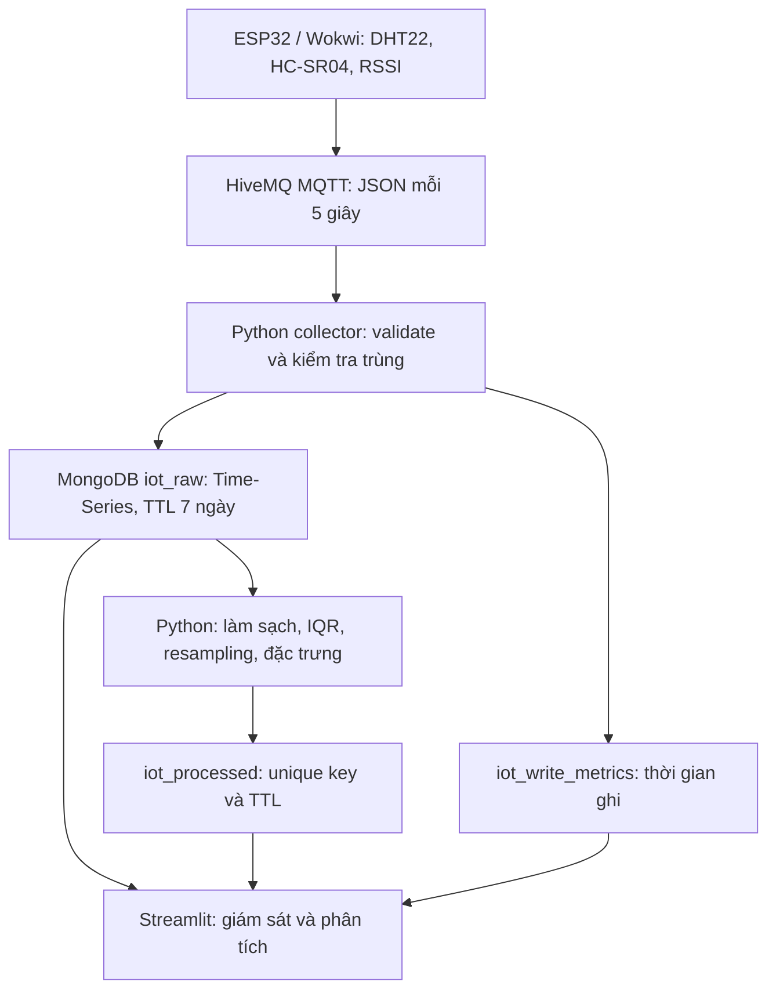

# Hướng dẫn báo cáo và demo – Bài thực hành số 2

Bố cục dưới đây đối chiếu **Bài thực hành số 2 – Thu thập, lưu trữ và tiền xử lý dữ liệu IoT**, mục 6–7. Báo cáo Word cần **4–6 trang**; nếu làm bìa riêng, hỏi giảng viên bìa có tính vào giới hạn hay không. Không dùng dữ liệu demo làm kết quả thực nghiệm.

## Bố cục 6 trang đề xuất

| Trang | Nội dung | Minh chứng cần lấy từ hệ thống thật |
|---|---|---|
| 1 | Mục tiêu, công cụ, kiến trúc ESP32 → MQTT → Python → MongoDB → Streamlit | Sơ đồ kiến trúc, chu kỳ publish, topic (không chứa thông tin đăng nhập) |
| 2 | Thu thập, validation, schema Time-Series, chống trùng và retention | JSON bản tin, ảnh Atlas schema + TTL, log collector |
| 3 | Làm sạch, IQR, resampling, nội suy, rolling mean, delta, Min–Max | Thống kê chạy pipeline, ảnh so sánh raw/processed |
| 4 | App ứng dụng: 4 tab, lọc thời gian, tự làm mới, export và xem trước/lưu | Ảnh tab giám sát và tiền xử lý với dữ liệu thật |
| 5 | Thực nghiệm: dữ liệu thiếu/trùng, reboot, thời gian ghi, dung lượng | JSON đánh giá, bảng mean/P95/min/max, biểu đồ độ trễ |
| 6 | Phân tích giới hạn, khó khăn và giải pháp, hướng cải tiến | Kết luận theo số liệu thu được; nêu phần chưa đo/kiểm chứng |

Có thể rút thành 5 trang bằng cách gộp ứng dụng và thực nghiệm; tránh đưa quá nhiều ảnh nhỏ, khó đọc. Mỗi hình có số thứ tự, chú thích và câu phân tích trong nội dung.

## Kiến trúc để vẽ lại trong báo cáo

## Schema cần mô tả

| Collection | Trường quan trọng | Vai trò |
|---|---|---|
| `iot_raw` | `time` (BSON UTC Date), `metadata.device_id`, temperature, humidity, distance_cm, rssi, sequence, uptime_s, received_at, latency_ms | Bản tin gốc; `timeField=time`, `metaField=metadata`; giữ khoảng 7 ngày theo TTL |
| `iot_processed` | time, metadata.device_id, window_seconds, sample_count, was_missing_window, outlier_count, processed_at, các trường cảm biến/rolling/delta/norm | Collection thường; upsert theo (device_id, time, window_seconds); TTL 7 ngày |
| `iot_processed` v2 | pipeline_version, missing_by_sensor, outliers_by_sensor, imputed_by_sensor | Theo dõi thiếu, outlier và nội suy theo cảm biến trong mỗi cửa sổ |
| `iot_write_metrics` | sensor_time, received_at, stored_at, mongodb_insert_ms, collector_to_db_ms, observed_sensor_to_store_ms | Phép đo thời gian Python ghi MongoDB; không phải E2E đã kiểm chứng |

Trong JSON xuất CSV, giờ Việt Nam có offset +07:00; database lưu UTC. `null` thể hiện chưa có giá trị, không phải số 0.

## Tiền xử lý – giải thích đúng thuật toán đang chạy

1. Loại timestamp không hợp lệ; loại trùng `(time, sequence)` trong từng thiết bị. Sequence lặp ở thời điểm khác, ví dụ sau reboot, được giữ lại.
2. Chuyển về số và kiểm tra miền vật lý: nhiệt độ [-40,80] °C; độ ẩm [0,100]%; khoảng cách [0.1,450] cm; RSSI [-130,0] dBm. Giá trị không hữu hạn thành missing.
3. Với ba cảm biến chính, tính IQR khi có ≥8 giá trị và IQR>0. Đánh dấu và loại khỏi phép lấy trung bình các điểm ngoài `[Q1−1.5IQR, Q3+1.5IQR]`. Dữ liệu hằng không bị tự động coi là outlier.
4. Gộp trung bình theo cửa sổ 15/30/60/300 giây, đếm số mẫu và số giá trị outlier. Một bản tin có thể có nhiều giá trị outlier; không gọi `outlier_count` là số bản tin lỗi.
5. Nội suy **chỉ toàn bộ khoảng trống nằm giữa hai giá trị và dài tối đa 2 cửa sổ**. Khoảng dài hơn và khoảng ở hai đầu vẫn missing. Không thay các đợt mất kết nối dài bằng số liệu giả.
6. Rolling mean 3 cửa sổ, delta, Min–Max theo khoảng dữ liệu của lần chạy. Rolling mean ở cửa sổ vẫn thiếu được giữ null; delta qua khoảng thiếu cũng null.
7. Lưu vào collection mới qua upsert. Chạy lại có thể thay đổi các giá trị và chuẩn hóa của cửa sổ cũ vì nguồn dữ liệu/phạm vi đã đổi. Các cửa sổ ngoài phạm vi chạy được giữ nguyên; không có cam kết tất cả cửa sổ trong collection thuộc cùng một lần chạy. Khi so sánh kết quả, dùng cùng thiết bị, phạm vi và tham số; kiểm tra `processed_at`.

**Cần nhận xét:** Nếu bạn cố ý đổi nhiệt độ hoặc khoảng cách trong Wokwi, một spike có thể là tín hiệu thật. IQR chỉ là phương pháp thống kê, cần đối chiếu kịch bản thử nghiệm. Chuẩn hóa là phục vụ phân tích, không giữ đơn vị vật lý.

## Kịch bản thử và bảng kết quả

Chọn cùng một thiết bị, cùng một khoảng thời gian và cửa sổ 30 giây. Thu dữ liệu đủ lâu để có nhiều cửa sổ (đề không quy định số bản tin tối thiểu).

| Kịch bản | Cách thực hiện | Điều cần quan sát |
|---|---|---|
| Bình thường | Wokwi + 1 collector; cảm biến ổn định | Chu kỳ khoảng 5s; bản ghi mới; mean/P95 ghi DB |
| Thay cảm biến | Thay nhiệt độ/độ ẩm/khoảng cách và ghi mốc thời gian | Raw thay đổi; processed và rolling phản ứng; có bị IQR đánh dấu không |
| Reboot | Dừng Wokwi 20s rồi chạy lại | sequence và uptime_s giảm; phân biệt reset với thiếu sequence |
| Ngừng thu thập | Dừng collector >90s, giữ Wokwi chạy; chạy lại collector | Nghi thiếu sequence; các cửa sổ dài không bị nội suy một phần |
| Chạy lại pipeline | Chạy tiền xử lý hai lần với cùng dữ liệu/phạm vi | Không tăng số cửa sổ trùng theo khóa unique; processed_at cập nhật |

MQTT public QoS 0 không bảo đảm giao nhận. Không quy kết mọi sequence thiếu là mất gói mạng. Collector có thể đã dừng hoặc publish thất bại. Chỉ chạy một collector và một tiến trình tiền xử lý mỗi lúc.

| Chỉ số cần điền | Nguồn |
|---|---|
| Phạm vi UTC và thiết bị | JSON đánh giá tải từ app |
| Số mẫu gốc/cửa sổ xử lý trong khoảng chọn | Dashboard; lưu ý cờ truncated |
| Trùng, sequence nghi thiếu, reboot | Tab Chất lượng & độ trễ |
| Thiếu/ngoài miền/outlier theo cảm biến | Xem trước tiền xử lý → tải JSON thống kê |
| Cửa sổ được nội suy và còn thiếu | Bảng chi tiết từng cảm biến |
| Mean, P95, min, max và số phép đo hợp lệ | Tab Chất lượng & độ trễ; JSON đánh giá |
| Dạng collection và TTL thực tế | `python evaluate_iot.py`, Atlas |
| Dung lượng | BSON mẫu trong app chỉ là ước tính trên các trường đã tải; muốn dung lượng thực dùng thống kê Atlas |

## Phân tích độ trễ và giới hạn cần nêu

- `mongodb_insert_ms`: thời gian gọi insert đến khi được xác nhận, đo bằng đồng hồ đơn điệu Python.
- `collector_to_db_ms`: từ đầu callback MQTT đến khi insert được xác nhận; gồm validation, truy vấn và ghi, chưa bao gồm ESP32/broker.
- `received_at − time` hoặc `stored_at − time`: chênh lệch **hai đồng hồ**, có thể âm hoặc rất lớn do clock skew.
- Đề yêu cầu đánh giá **end-to-end**: các phép đo trong app hiện tại chưa chứng minh được độ trễ thiết bị → database. Muốn hoàn tất phần này cần đồng bộ và kiểm chứng độ lệch NTP của ESP32 và máy Python, sau đó báo chênh lệch timestamp kèm sai số. Nêu rõ phần chưa kiểm chứng thay vì gọi thời gian ghi DB là E2E.
- Thống kê chất lượng chỉ tính các bản ghi đã lưu, không có tổng bản tin bị collector từ chối. Không gọi phần trăm hợp lệ của bản ghi đã lưu là tỷ lệ thành công của toàn pipeline.
- Thời gian làm mới app là 10/30/60 giây; tiền xử lý chưa phải streaming liên tục. Số liệu toàn database trong CLI và số liệu khoảng chọn trong app có thể khác nhau.

## Ảnh cần chụp và demo 3–5 phút

Chụp 6 minh chứng: mạch Wokwi + publish; log collector lưu; Atlas schema + TTL; dashboard tổng quan; raw vs processed cùng thống kê; mean/P95 và biểu đồ thời gian ghi. Chọn 3–4 ảnh rõ nhất đưa vào báo cáo, các ảnh còn lại dùng khi demo.

Demo: mở app **tắt chế độ demo** → thay cảm biến để thấy tự cập nhật → xem trước pipeline → lưu kết quả (nếu bật quyền ghi) → so sánh raw/processed → xem chất lượng và P95 → xuất CSV/JSON. Không hiện URI/mật khẩu trong ảnh hoặc quay màn hình.

## Checklist trước khi nộp

- [ ] Source firmware, collector, preprocessing, config mẫu và README trên GitHub.
- [ ] Pipeline chạy với dữ liệu thật; 1 collector; database có Time-Series và retention.
- [ ] Tiền xử lý có kết quả lưu trong collection mới; giải thích các lựa chọn và giới hạn.
- [ ] App có thể demo; tự làm mới hoạt động; dữ liệu cũ có nhãn trạng thái đúng.
- [ ] Báo cáo Word 4–6 trang, sơ đồ, schema, ảnh thật, bảng số liệu, phân tích độ trễ/lưu trữ, khó khăn và giải pháp.
- [ ] Nêu rõ tình trạng kiểm chứng phép đo end-to-end, không lấy kết quả demo hay lịch sử để giả làm phép đo mới.
